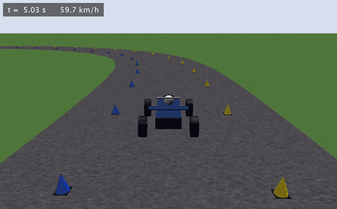
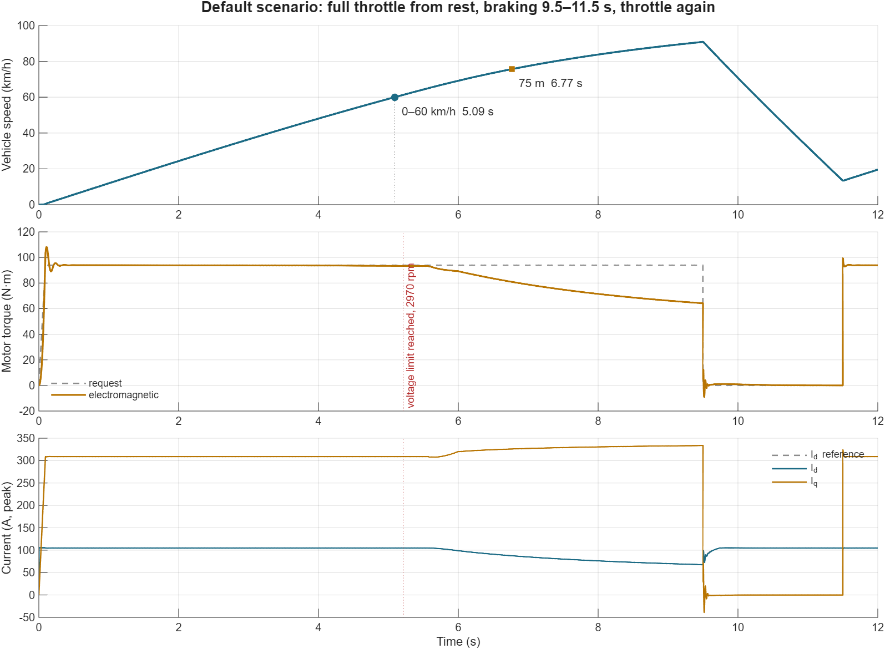
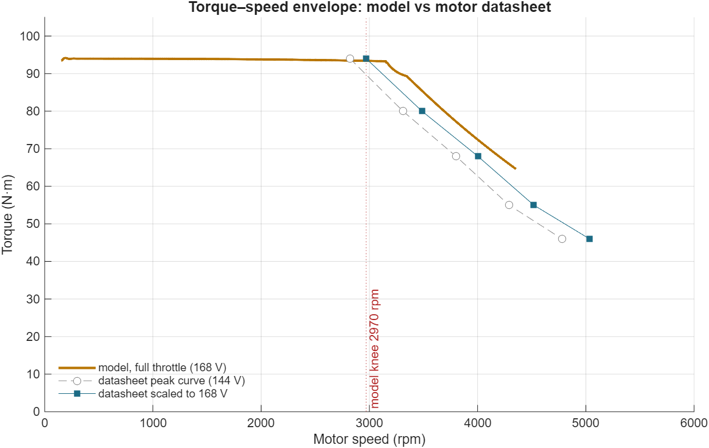
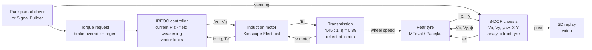
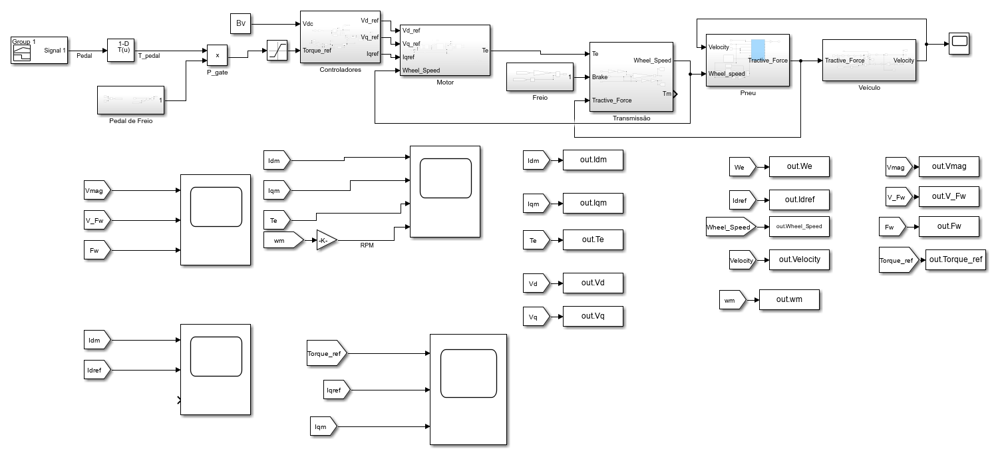
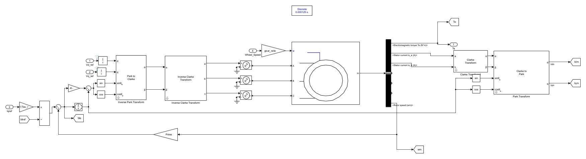
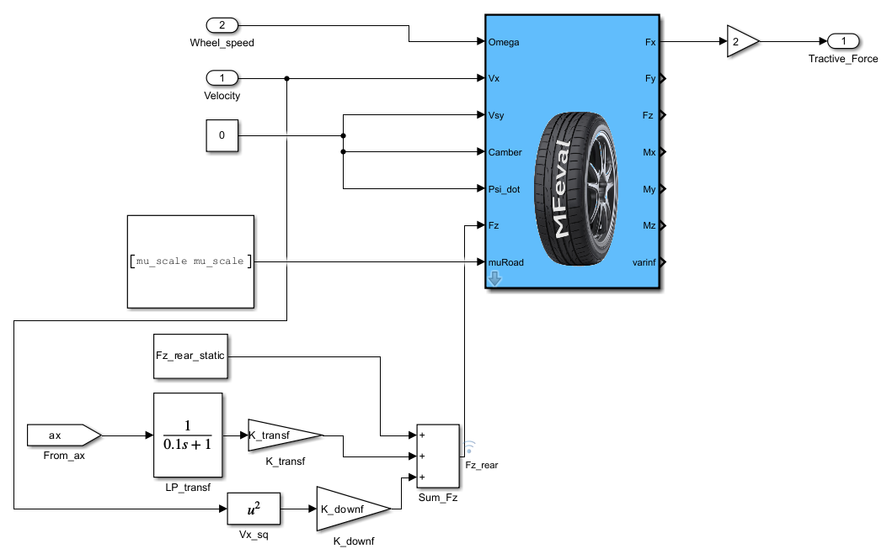
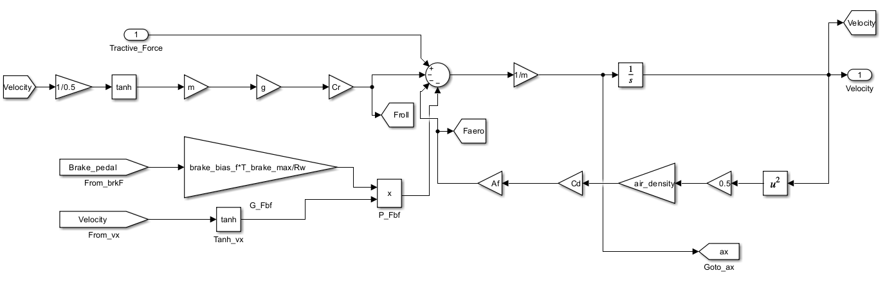
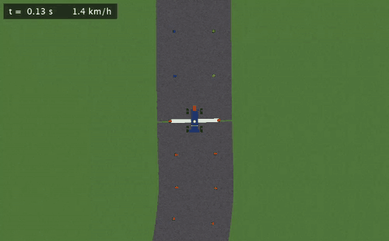

# AMP-226 Electric Powertrain Model

**Induction motor, IRFOC field-oriented control, 3-DOF vehicle dynamics, regenerative braking and an autonomous lap in MATLAB/Simulink**

> **Branch `develop`.** This branch adds lateral dynamics, regenerative braking, a track-following driver
> and a 3D replay on top of the longitudinal model. The motor and controller are the same as in
> [`main`](../../tree/main), where the longitudinal model is validated against the motor datasheet; the
> lateral parameters here are still estimates waiting for track data.

A physics-based simulation of the electric powertrain of **AMP-226**, the Formula SAE electric car of
**Ampera Racing** (Federal University of Santa Catarina, Brazil). It covers the whole chain from the
driver's inputs to the car's path on track: torque request and regen, the field-oriented current control of
the SEVCON Gen5 inverter, the 4-pole induction motor, the gearbox, the tyres and a 3-DOF chassis.



## Purpose

Every season the team designs a new car, but the powertrain architecture (induction motor, field-oriented
inverter, single-speed reduction, rear drive) carries over while the numbers change. This model is built
as a **modular, reusable tool**: replace the parameter set with next year's car data and the same model
answers the questions that drive the design and the setup of that car.

- **Design decisions for the next car.** Compare gear ratios, pack voltage and current limits, motor
  options, mass and aero targets by their effect on acceleration time, top speed, energy use and which
  limit (motor, inverter, battery or tyre) is active at each speed.
- **Inverter controller gains.** Design and stress-test the current-loop and field-weakening gains in
  simulation before they go on the SEVCON Gen5, where a bad gain means an inverter trip or an
  overheated motor instead of a plot.
- **Validation with the real car.** Feed logged inputs from track tests into the model and compare the
  outputs, to find which parameter, or which modelling assumption, is wrong.

## Highlights

**Powertrain**

- **Motor parameters identified from the manufacturer's dyno tables.** The original equivalent-circuit
  parameters were physically impossible: with the old torque constant, 110 A could produce at most
  24.4 N·m, while the dyno measured 35 N·m. A least-squares fit over the 20 rows of the datasheet's
  load tables (3.3 % RMS residual) gave a consistent set (Lm, Rr, Lσ, Kt, magnetising current).
- **Current loop designed analytically, not by trial and error.** Discrete PI at 8 kHz with
  Kp = σ·Ls·ωc and Ki = Req·ωc for a 200 Hz bandwidth, back-calculation anti-windup (Kaw = Ki/Kp),
  decoupling feed-forwards, and **vector** voltage and current limits with priority to the d axis.
- **Field-weakening bug traced to a sample-time problem.** The voltage-magnitude measurement chain was
  inheriting the solver rate (80 kHz) instead of the controller rate (8 kHz), so it read the
  intra-sample ripple peak (+26 V) and weakened the field far too early. Fixing the sample time
  removed the limit cycle and gave **+52 % torque for the same phase current at 4 800 rpm**.
- **Tyre model 11× faster without changing a single result.** MFeval's limit checks call `warning()` at
  every solver step outside the `.tir` range (low speed, hard braking); silencing those two warnings in
  `InitFcn` took heavy-braking segments from 0.21 to 2.4 simulated s per minute.

**Vehicle, driver and visualisation (this branch)**

- **3-DOF chassis** (longitudinal, lateral, yaw) with the velocity-coupling terms
  (V̇x = ΣFx/m + Vy·ψ̇, V̇y = ΣFy/m − Vx·ψ̇) and integrated X–Y position.
- **Two tyre models, chosen by measurement.** The driven rear axle keeps MFeval (combined slip decides
  launch and wheelspin). A second MFeval block made the model 52× slower, so the free-rolling front axle
  uses an analytic Magic Formula fitted to the same `.tir` file (fit error < 0.5 %).
- **Lift-off regenerative braking** as on the real car: when the throttle is released the motor brakes,
  limited by the smaller of a "coast feel" torque and the battery's charge-current limit, faded out
  below 5 km/h and rate-limited. The driveline efficiency is inverted in regen (wheel torque = motor
  torque × ratio / η), which the first version got wrong by ≈ 21 %.
- **Pure-pursuit driver** that laps a rule-compliant FSAE autocross track (generated from waypoints with a
  periodic spline), with speed targets from track curvature and lateral-acceleration limits.
- **3D replay**: the simulated pose is rendered in a VRML scene with cones, track texture and several
  cameras, and written to video. Simulink 3D Animation's classic viewer was removed in R2025a, so the
  pipeline renders off-screen, with a screen-capture fallback when MATLAB runs on the WebGL renderer.

## Results

### Autonomous lap


From a standing start the driver completes the 265 m autocross lap in **24.8 s** (mean 38 km/h, top speed
60 km/h on the first lap, 73 km/h on the flying second lap). Battery current peaks at 214 A in traction and
−58 A in regen, inside the 250 A / 60 A limits. Tyre grip is the bench value from the `.tir` file
(`mu_scale = 1`), so the lap time is optimistic: on track the grip is expected to be about 0.7 of that.

### Full-throttle run



### Motor and controller against the datasheet

The motor side is checked against the **load tables** of the datasheet, not the nameplate header: the
nameplate points are at saturated full flux, outside the range where the linear motor model is valid.
The first two rows are steady-state values computed from the identified parameters; the others come from
the full-throttle simulation above.

| Check | Target (datasheet) | Model |
| --- | --- | --- |
| Continuous 35 N·m, below base speed | 110–111 A RMS | 110.1 A RMS |
| Slip at 35 N·m | 3.0–3.3 Hz | 2.92 Hz |
| Peak torque | 94 N·m at 240 A RMS | 93.9 N·m at 230.7 A RMS |
| Slip at 94 N·m | ≈ 8 Hz | 7.83 Hz |
| Field-weakening knee at full torque | ≈ 2 970 rpm (2 820 rpm at 144 V, scaled to 168 V) | 2 968 rpm |



Below the knee the model sits on the datasheet's 94 N·m line. In deep field weakening it is 5–8 % above
the datasheet curve scaled to 168 V, for two known reasons: the motor model is magnetically linear (no
saturation or iron losses), and the speed scaling from the 144 V dyno test to the 168 V pack is an
approximation.

### Vehicle

With 366 kg (car and driver) and a full pack, the model predicts **0–60 km/h in 5.09 s** and the
**75 m FSAE acceleration event in 6.77 s**. These numbers depend on parameters that still have to be
confirmed on track (rolling resistance, rotating inertias, tyre grip); see the [roadmap](#roadmap).

### Lateral model: internal consistency checks

| Check | Result |
| --- | --- |
| Lateral force balance in steady cornering: ΣFy vs m·ay | 4 338 N vs 4 338 N |
| Yaw rate at 23.5 m/s, 0.03 rad steer: model vs analytic bicycle model with load-dependent stiffness | 0.509 vs 0.496 rad/s (2.6 %) |
| Braking at 60 % pedal: model vs T_brake·pedal / (Rw·m·g) | 1.09 g, matches |
| Front wheel load under braking | 870 N static → 1 389 N |

These confirm the equations are implemented consistently. They do not validate the estimated parameters
(yaw inertia, brake torque, tyre grip on track), which need the track tests.

## How the model works



The full model, `pwtsimplificado.slx`, has these subsystems:

| Subsystem | What it does |
| --- | --- |
| **Controller** | IRFOC current control and field weakening, the same as in `main`. |
| **Motor and inverter** | Ideal inverter, coordinate transforms, rotor-flux angle and the Simscape induction machine. |
| **Transmission** | Gear reduction and driveline dynamics; the efficiency is inverted when the motor regenerates. |
| **Rear tyre** | MFeval with dynamic vertical load and lateral slip from the chassis. |
| **Front tyre** | Analytic Magic Formula fitted to the same `.tir`, with load-dependent cornering stiffness and a friction ellipse shared with the front brake force. |
| **Vehicle** | 3-DOF chassis: longitudinal, lateral and yaw equations, rolling resistance, drag, downforce and X–Y integration. |
| **Steering** | Steering source selected by `steer_mode`: step, slalom, constant radius (skidpad), a logged signal, or the driver. |
| **Regenerative braking** | Lift-off regen torque with the battery charge limit, low-speed fade and rate limit. |
| **Rear brake and pedal safety** | Friction brake split by bias, and the brake override that cuts motor torque. |
| **DC monitor** | DC-side power, battery current and recovered energy. |
| **Driver** | Pure-pursuit steering and speed-target throttle and brake on the track in `data/pista_amp226.mat`. |
| **3D pose** | Packs position, attitude, steering and wheel angles for the 3D replay. |

### Inside the longitudinal core

The figures below are from `pwtsimplificado_longitudinal.slx`. The controller, motor and transmission are
identical in the full model; there, the tyre and vehicle subsystems are replaced by the two tyre models and
the 3-DOF chassis listed above.

#### Top level



The upper row is the signal chain, from left to right:

| Subsystem | What it does |
| --- | --- |
| **Driver input** | A Signal Builder with the throttle profile, expressed as a torque request in N·m and passed through a lookup table. |
| **Brake pedal** | Brake pedal profile, and the brake-override gate (`P_gate`) that cuts motor torque once the pedal passes `brake_cut`. The torque request is then limited to `T_max`. |
| **Controller** | IRFOC current control and field weakening; turns the torque request into the voltage references `Vd_ref` and `Vq_ref`. |
| **Motor and inverter** | Inverter as an ideal voltage source, coordinate transforms, rotor-flux angle and the Simscape induction machine. |
| **Rear brake** | Rear share of the brake torque, applied at the wheel. |
| **Transmission** | Gear reduction and the rotational dynamics of the driveline. |
| **Rear tyre** | MFeval tyre model with dynamic vertical load; returns the tractive force. |
| **Vehicle** | Longitudinal equation of motion; returns the vehicle speed. |

The lower part only logs signals, to scopes and to the workspace (`out.Idm`, `out.Te`, `out.Velocity`, …),
which is what the post-processing scripts read. Car-specific values come from named parameters in the
Model Workspace rather than numbers typed into the blocks (the pack voltage constant reads `Bv`).

#### Controller (`Controladores`)


The indirect rotor-flux-oriented controller that runs inside the SEVCON Gen5, discretised at 8 kHz.

- **Field weakening (top branch).** The available phase voltage is `V_lim = Vdc/√3 · Modulation_Target`.
  The applied voltage magnitude `Vmag = √(Vd² + Vq²)` is taken from the previous sample (`1/z`) and
  low-pass filtered at 50 Hz (`(1 − a)/(z − a)`). Their difference drives an anti-windup PI whose output
  `Fw` can only reduce the magnetising current: `Idref = Imag + Fw`, with `Fw ≤ 0`.
- **d-axis current loop.** `Idref − Idm` goes into an anti-windup PI. The decoupling feed-forward
  `−We·Iqm·σ·Ls` cancels the cross-coupling from the q axis, and the result is the d-axis voltage `Vd_ref`.
- **q-axis current loop (bottom branch).** The torque request becomes a current request through
  `Iq = T / (Kt · Idref)`, which follows from `Te = Kt · Id · Iq`. That request is clipped to `±Iq_sat`,
  where `Iq_sat = √(I_max² − Idref²)`, so the d axis always keeps priority on the current limit. The q-axis
  PI and the back-EMF feed-forward produce `Vq_ref`.

#### Motor and inverter (`Motor`)



- **Actuation path.** `Vd_ref` and `Vq_ref` pass through a one-sample delay (the computation delay of a
  real controller), then the inverse Park and inverse Clarke transforms, and drive three controlled voltage
  sources connected to the Simscape asynchronous machine. PWM switching is not modelled; the inverter is an
  ideal average voltage source.
- **Rotor-flux angle.** The slip frequency `Iqref / (Tau_r · Idref)` is added to the electrical rotor
  speed `Poles · wm` to get the synchronous speed `We`, which is integrated into the flux angle θ. The
  angle used by the inverse Park transform is advanced by `We · 1.5 · Ts` to compensate the sample and
  hold delays.
- **Measurement path.** Phase currents a and b go through Clarke and Park with the same angle to give
  `Idm` and `Iqm`, the feedback of the current loops. The machine also returns the electromagnetic torque
  `Te` and the rotor speed `wm`.
- The machine runs in speed-input mode: its shaft speed is the wheel speed times `gear_ratio`, so all the
  mechanical dynamics live in the transmission.

#### Transmission (`Transmissão`)


A single rigid driveline written at the wheel:

```math
(I_w + I_m \cdot gr^2)\,\dot\omega_{wheel} = T_e \cdot gr \cdot \eta \;-\; F_x R_w \;-\; T_{brake}
```

The integrator output is the wheel speed. The load torque seen by the motor,
`(Fx·Rw + T_brake) / gr / η`, is sent back as `Tm` for monitoring.

#### Rear tyre (`Pneu`)



The MFeval block evaluates the Pacejka (PAC2002) model of the Avon tyre, fitted to FSAE Tire Test
Consortium data, from wheel speed and vehicle speed. Its output `Fx` is per tyre, so it is doubled for the
two driven wheels. The vertical load is dynamic:

```math
F_{z,rear} = F_{z,static} + K_{transf}\,\frac{a_x}{0.1\,s + 1} + K_{downf}\,V_x^2
```

Load transfer follows the vehicle's acceleration, filtered at 0.1 s to break the algebraic loop
Fz → Fx → ax → Fz, and the downforce term grows with speed squared. `mu_scale` scales the bench friction of
the `.tir` file down to track grip.

#### Vehicle (`Veículo`)



```math
m\,\dot V = F_{tractive} - \tanh\!\left(\tfrac{V}{0.5}\right) m g C_r - \tfrac12 \rho C_d A_f V^2 - F_{brake,front}
```

The `tanh` terms smooth rolling resistance and the front brake force around zero speed, so the car does not
roll backwards when it stops. The front brake force is `Brake_pedal · brake_bias_f · T_brake_max / Rw`; the
rear share of the brake torque acts on the wheel in the transmission. The acceleration is published as `ax`
for the tyre load model.

## Parameters


All parameters are defined by a commented MATLAB script stored inside the model (Model Explorer →
`pwtsimplificado` → Model Workspace, data source *MATLAB Code*). Each line states where its value comes from.
Derived quantities such as `sigma`, `Tau_r`, `Kt`, the PI gains and the current limits are computed in the
same script, so changing a motor or battery value updates every block that depends on it.

| Group | Parameter | Value | Source |
| --- | --- | --- | --- |
| Battery | Pack voltage / max DC current | 168 V (full) / 250 A | car spec |
| Motor | Rated power / peak torque | 11 kW / 94 N·m | datasheet |
| Motor | Lm, Rr, Lσs = Lσr | 1.036 mH, 18.6 mΩ, 74.8 µH | identified |
| Motor | Rs | 16.5 mΩ | datasheet |
| Motor | Kt (peak currents), Imag | 2.898 mN·m/A², 105 A peak | identified |
| Inverter | Phase current limit | 342 A peak (motor 2-min limit) | datasheet |
| Control | Sampling, current-loop bandwidth | 8 kHz, 200 Hz | design |
| Control | Kp, Ki | 0.182 V/A, 41.0 V/(A·s) | design |
| Driveline | Gear ratio, efficiency, wheel radius | 4.45, 0.89, 0.2605 m | car spec |
| Vehicle | Mass, CdA, Cr | 366 kg, 1.24 m², 0.02 | car spec |
| Vehicle | Wheelbase, CG height, rear weight | 1.56 m, 0.295 m, 51.5 % | car spec |
| Chassis | Yaw inertia Iz | 120 kg·m² | estimated |
| Brakes | Max brake torque, front bias | 1 700 N·m, 70 % | estimated |
| Regen | Max charge current `Bi_regen` | 60 A | estimated |
| Tyre | Grip scale on track `mu_scale` | 1.0 (bench); ≈ 0.7 expected on track | to be measured |

Phase currents and voltages are **peak values** (amplitude-invariant Park/Clarke); datasheet RMS values are
multiplied by √2.

### Adapting the model to a new car

The block diagram only reads parameter names, so a new car means a new parameter set, not a new model.
The script is grouped by subsystem:

| Group | What to update | Typical source |
| --- | --- | --- |
| Accumulator | `Bv`, `Bi` | pack design, BMS limits |
| Motor | `Rs`, `Rr`, `Lls`, `Llr`, `Lm`, `Poles`, `Im`, `T_max`, `I_max_motor` | datasheet, or identification from dyno tables |
| Inverter | `I_max_inv`, `mc_eff`, `Amostragem` | inverter datasheet |
| Controllers | `wc`, `wc_fw`, `Fw_margin`, `Modulation_Target` | design choices; `Kp`, `Ki`, `Kaw` and the field-weakening gains are **derived** from the motor data |
| Driveline | `gear_ratio`, `trans_eff`, `Rw`, `Iw` | drivetrain design, CAD |
| Brakes | `T_brake_max`, `brake_bias_f`, `brake_cut` | brake sizing, VCU strategy |
| Vehicle | `m`, `Cd`, `Af`, `Cr`, `L_wb`, `dist_cg_f`, `h_cg`, `ClA_total`, `downforce_rear_share` | weighing, aero simulations, CAD |
| Chassis | `Iz`, `roll_grad`, `pitch_grad` | CAD, suspension design |
| Regen | `Bi_regen`, `regen_coast`, `T_regen_max`, `v_regen_off` | cell datasheet, BMS, VCU strategy |
| Tyre | the `.tir` file in `data/`, `mu_scale` | tyre test data (TTC or supplier), track tests |
| Track and driver | `data/pista_amp226.mat`, `pp_*` | `gerar_pista_fsae`, driver tuning |

Every time the model loads, the script prints the derived quantities (σ, τr, Kt, controller gains,
`Kaw·Ts`, `wc·Ts`, maximum reachable torque) next to the datasheet acceptance targets, so an inconsistent
parameter set shows up before the first simulation. The expected values in those messages are AMP-226's and
should be updated with the new car's datasheet.

## Getting started

**Requirements**

- MATLAB **R2025a**, Simulink, Simscape, Simscape Electrical
- [MFeval](https://www.mathworks.com/matlabcentral/fileexchange/63618-mfeval) (free, MATLAB File Exchange)
- For the 3D replay only: Simulink 3D Animation, Computer Vision Toolbox (video overlay text) and
  Curve Fitting Toolbox (track spline)

**Run a lap**

```matlab
% from the repository root
addpath(genpath(pwd))
out = sim('pwtsimplificado');      % 34 s: one standing-start lap plus part of a flying lap
plot_volta(out)                    % lap map and traces -> docs/img/lap_map.png
```

The full model runs at roughly 0.08× real time (about 7 minutes for the 34 s lap). By default the driver
is on (`steer_mode = 5`, `piloto_on = 1`); set them back in the Model Workspace to use the Signal Builder
and the steering test inputs instead.

**Render the lap in 3D**

```matlab
cd visualization
gravar_replay3d('lap.mp4', 'Perseguicao')   % uses the saved pose in replay3d.mat, no re-simulation
fazer_replay3d('lap.mp4')                   % or: simulate, convert the pose and record in one go
```

`gerar_pista_fsae` regenerates the track from its waypoints and checks it against the FSAE autocross
rules; `gerar_cena_amp226` rebuilds the VRML scene (car, cones, textures, cameras).

**Longitudinal model** (same as `main`)

```matlab
out = sim('pwtsimplificado_longitudinal');   % 12 s full-throttle run, then braking
plot_resultados(out)
```

## Repository structure

```
├── pwtsimplificado.slx                Full model: 3-DOF chassis, regen, driver, 3D pose
├── pwtsimplificado_longitudinal.slx   Longitudinal model (same as main)
├── data/
│   ├── Avon_9760_Round_2.tir          Tyre coefficients for MFeval
│   └── pista_amp226.mat               FSAE autocross track (centre line, curvature, cones)
├── scripts/
│   ├── plot_resultados.m              Figures of the longitudinal run
│   └── plot_volta.m                   Lap map and traces
├── visualization/
│   ├── gerar_pista_fsae.m             Track generator with FSAE rule checks
│   ├── gerar_cena_amp226.m            VRML scene (car, cones, textures, cameras)
│   ├── prepara_replay3d.m             Simulated pose -> scene coordinates
│   ├── animar_replay3d.m              Off-screen rendering to video
│   ├── fazer_replay3d.m               Simulate + record in one call
│   ├── gravar_replay3d.m              Record from a saved pose
│   ├── build_replay3d_slx.m           Simulink replay model (VR Sink)
│   ├── amp226.wrl, *.png              Scene and textures
│   └── replay3d.mat                   Saved pose of the lap
├── tools/
│   ├── add_piloto.m                   Script that added the driver subsystem to the model
│   └── dump_modelo.m                  Text dump of the model structure
└── docs/
    └── img/                           Figures and GIFs used in this README
```

## Roadmap and known limitations

- **Track validation.** The motor side is validated against the manufacturer's dyno data; the vehicle side
  still relies on estimated parameters (brake torque, rotating inertias, tyre grip on track). The test plan
  replays measured inputs (motor speed, inverter torque, brake pressure) into the model one layer at a time
  and compares the outputs, so that a mismatch points to one parameter instead of fifteen.
- **Battery model.** The pack is a constant 168 V source; voltage sag under load moves the
  field-weakening knee and is not yet included.
- **Thermal and inverter limits.** No thermal derating of motor or inverter, and none of the SEVCON's
  internal ramps.
- **Lateral parameters.** Yaw inertia, brake torque, the regen charge limit and track grip are estimates
  until the track tests.
- **Roll and pitch** are synthesised from ay and ax by quasi-static gradients for the 3D view; the chassis
  has no roll or pitch dynamics.



## Resumo em português

Modelo em MATLAB/Simulink do powertrain elétrico do **AMP-226**, carro de Formula SAE elétrico da
**Ampera Racing (UFSC)**: motor de indução Hércules com controle vetorial IRFOC (SEVCON Gen5),
transmissão, pneu Pacejka via MFeval e dinâmica do veículo. A simulação é modular: trocando o conjunto de
parâmetros pelos dados do carro do ano seguinte, o mesmo modelo serve para decisões de projeto do carro
futuro (relação de transmissão, tensão e corrente do acumulador, motor, massa, aerodinâmica) e para
encontrar ganhos melhores para os controladores do inversor antes de passá-los ao SEVCON Gen5.

Os parâmetros do motor foram identificados por mínimos quadrados a partir das tabelas de dinamômetro da
folha de dados, os controladores de corrente e de enfraquecimento de campo foram projetados
analiticamente, e o modelo reproduz os pontos de teste do fabricante (torque, corrente, escorregamento e
joelho do enfraquecimento de campo).

A branch `main` contém a versão longitudinal validada; esta branch, `develop`, traz o chassi 3-DOF,
regeneração, piloto automático de pista e o replay 3D. Os parâmetros laterais (inércia de guinada, freio,
aderência em pista) ainda são estimativas que serão conferidas nos testes com o carro.

## Author

**Gabriel Hessmann Ramos** ([@GabrielH2003](https://github.com/GabrielH2003)) — powertrain team, Ampera Racing UFSC.
Vehicle data courtesy of Ampera Racing.
