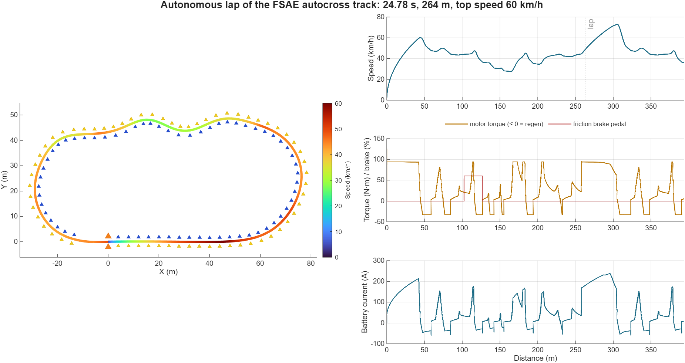
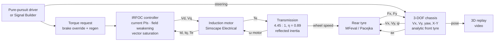

# AMP-226 Electric Powertrain Model

**Induction motor + IRFOC field-oriented control + 3-DOF vehicle dynamics, regenerative braking and an autonomous lap, in MATLAB/Simulink**

> **Branch `develop`.** This branch adds lateral dynamics, regenerative braking, a track-following driver
> and a 3D replay on top of the longitudinal model. The motor and controller are the same as in
> [`main`](../../tree/main), where the longitudinal model is validated against the motor datasheet; the
> lateral parameters here are still estimates waiting for track data.


A physics-based simulation of the electric powertrain of **AMP-226**, the Formula SAE electric car of
**Ampera Racing** (Federal University of Santa Catarina, Brazil).
It models the whole chain from the driver's inputs to the car's path on track:

> driver (pedals, steering) → torque request and **regen** → **IRFOC current control (SEVCON Gen5)** → **4-pole induction motor** → gearbox → **tyres** → **3-DOF chassis**


## Purpose

Every season the team designs a new car, but the powertrain architecture (induction motor, field-oriented
inverter, single-speed reduction, rear drive) carries over while the numbers change. This model is built
as a **modular, reusable tool**: replace the parameter set with next year's car data and the same model
answers the questions that drive the design and the setup of that car.

- **Design decisions for the next car.** Compare gear ratios, pack voltage and current limits, motor
  options, mass and aero targets by their effect on acceleration time, top speed, energy use and which
  limit (motor, inverter, battery or tyre) is active at each speed.
- **Inverter controller gains.** Design and stress-test the current-loop and field-weakening gains in
  simulation before they go on the SEVCON Gen5, where a bad gain means an inverter trip or an
  overheated motor instead of a plot.
- **Validation with the real car.** Feed logged inputs from track tests into the model and compare the
  outputs, to find which parameter, or which modelling assumption, is wrong.


---

## Highlights

- **Motor parameters identified from the manufacturer's dyno tables.** The original equivalent-circuit
  parameters were physically impossible: with the old torque constant, 110 A could produce at most
  24.4 N·m, while the dyno measured 35 N·m. A least-squares fit over the 20 rows of the datasheet's
  load tables (3.3 % RMS residual) gave a consistent set (Lm, Rr, Lσ, Kt, magnetising current).
- **Current loop designed analytically, not by trial and error.** Discrete PI at 8 kHz with
  Kp = σ·Ls·ωc and Ki = Req·ωc for a 200 Hz bandwidth, back-calculation anti-windup (Kaw = Ki/Kp),
  decoupling feed-forwards, and **vector** voltage and current saturation with priority to the d axis.
- **Field-weakening bug traced to a sample-time problem.** The voltage-magnitude measurement chain was
  inheriting the solver rate (80 kHz) instead of the controller rate (8 kHz), so it read the
  intra-sample ripple peak (+26 V) and weakened the field far too early. Fixing the sample time
  removed the limit cycle and gave **+52 % torque for the same phase current at 4 800 rpm**.
- **Tyre model 11× faster without changing a single result.** MFeval's limit checks call `warning()` at
  every solver step outside the `.tir` range (low speed, hard braking); silencing those two warnings in
  `InitFcn` took heavy-braking segments from 0.21 to 2.4 simulated s per minute.
- **Dynamic rear-axle load** from longitudinal load transfer and aerodynamic downforce, with a
  first-order filter that breaks the Fz → Fx → ax → Fz algebraic loop.

**Added in this branch**

- **3-DOF chassis** (longitudinal, lateral, yaw) with the velocity-coupling terms
  (V̇x = ΣFx/m + Vy·ψ̇, V̇y = ΣFy/m − Vx·ψ̇) and integrated X–Y position.
- **Two tyre models, chosen by measurement.** The driven rear axle keeps MFeval (combined slip decides
  launch and wheelspin). A second MFeval block made the model 52× slower, so the free-rolling front axle
  uses an analytic Magic Formula fitted to the same `.tir` file (fit error < 0.5 %).
- **Lift-off regenerative braking** as on the real car: when the throttle is released the motor brakes,
  limited by the smaller of a "coast feel" torque and the battery's charge-current limit, faded out
  below 5 km/h and rate-limited. The driveline efficiency is inverted in regen (wheel torque = motor
  torque × ratio / η), which the first version got wrong by ≈ 21 %.
- **Friction brakes** with front/rear bias, a friction-ellipse limit on the front axle, and brake
  override that cuts motor torque.
- **Pure-pursuit driver** that laps a rule-compliant FSAE autocross track (generated from waypoints with a
  periodic spline), with speed targets from track curvature and lateral-acceleration limits.
- **3D replay**: the simulated pose is rendered in a VRML scene with cones, track texture and several
  cameras, and written to video. Simulink 3D Animation's classic viewer was removed in R2025a, so the
  pipeline renders off-screen, with a screen-capture fallback when MATLAB runs on the WebGL renderer.

## Validation against the motor datasheet

The model is checked against the **load tables** of the datasheet, not the nameplate header (the
nameplate points are at saturated full flux, outside the linear model's validity range).

Rows 1–2 are steady-state values computed from the identified parameters; rows 3–5 come from the
full-throttle simulation below.

| Check | Target (datasheet) | Model |
| --- | --- | --- |
| Continuous 35 N·m, below base speed | 110–111 A RMS | 110.1 A RMS |
| Slip at 35 N·m | 3.0–3.3 Hz | 2.92 Hz |
| Peak torque | 94 N·m at 240 A RMS | 93.9 N·m at 230.7 A RMS |
| Slip at 94 N·m | ≈ 8 Hz | 7.83 Hz |
| Field-weakening knee at full torque | ≈ 2 970 rpm (2 820 rpm at 144 V, scaled to 168 V) | 2 968 rpm |

Vehicle-level predictions (366 kg with driver, full pack): **0–60 km/h in 5.09 s** and the
**75 m FSAE acceleration event in 6.77 s**. These are still to be confirmed on track — see
[Validation plan](#validation-plan).

### Lateral model: internal consistency checks

| Check | Result |
| --- | --- |
| Lateral force balance in steady cornering: ΣFy vs m·ay | 4 338 N vs 4 338 N |
| Yaw rate at 23.5 m/s, 0.03 rad steer: model vs analytic bicycle model with load-dependent stiffness | 0.509 vs 0.496 rad/s (2.6 %) |
| Braking at 60 % pedal: model vs T_brake·pedal / (Rw·m·g) | 1.09 g, matches |
| Front wheel load under braking | 870 N static → 1 389 N |

These confirm the equations are implemented consistently. They do not validate the estimated parameters
(yaw inertia, brake torque, tyre grip on track), which need the track tests.

### Autonomous lap



From a standing start the driver completes the 265 m autocross lap in **24.8 s** (mean 38 km/h, top
speed 60 km/h on the first lap, 73 km/h on the flying second lap). Battery current peaks at 214 A in
traction and −58 A in regen, inside the 250 A / 60 A limits. Tyre grip is the bench value from the
`.tir` file (`mu_scale = 1`), so the lap time is optimistic: on track the grip is expected to be about
0.7 of that.


Below the knee the model sits on the datasheet's 94 N·m line. In deep field weakening it is 5–8 % above
the datasheet curve scaled to 168 V. Two known reasons: the motor model is magnetically linear (no
saturation or iron losses), and the speed scaling from the 144 V dyno test to the 168 V pack is an
approximation. The battery is modelled as a constant 168 V source, so pack voltage sag under load is
not yet included.

## Model architecture



| Subsystem | What it does |
| --- | --- |
| **Controladores** | Indirect rotor-flux-oriented control: slip-frequency calculation, discrete d/q current PIs with anti-windup, decoupling and back-EMF feed-forwards, voltage-magnitude field-weakening PI, vector voltage/current limits, angle-delay compensation. |
| **Motor** | Simscape Electrical asynchronous machine (speed-imposed) fed by controlled voltage sources through inverse Park/Clarke, plus the measurement transforms. |
| **Transmissão** | Single-speed reduction, efficiency, motor + wheel inertia reflected to the wheel, rear brake torque. |
| **Pneu Traseiro** | MFeval (Pacejka MF 6.1) with the Avon `.tir` file; dynamic vertical load, lateral slip from the chassis. |
| **Pneu Dianteiro** | Analytic Magic Formula fitted to the same `.tir`, load-dependent cornering stiffness and friction, friction ellipse with the front brake force. |
| **Veículo** | 3-DOF chassis: longitudinal, lateral and yaw equations, rolling resistance, drag, downforce, X–Y integration. |
| **Direcao** | Steering source selected by `steer_mode`: step, slalom, constant radius (skidpad), logged signal, or the driver. |
| **Regen** | Lift-off regenerative torque with battery charge limit, low-speed fade and rate limit. |
| **Rear Brake / Segurança do Pedal** | Friction brake split by bias, brake override of motor torque. |
| **Monitor DC** | DC-side power, battery current and recovered energy. |
| **Piloto** | Pure-pursuit steering and speed-target throttle/brake on the track in `data/pista_amp226.mat`. |
| **Pose 3D** | Packs position, attitude, steering and wheel angles for the 3D replay. |

All parameters live in the **Model Workspace** (Model Explorer → `pwtsimplificado` → Model
Workspace, source *MATLAB Code*), with a comment on every line stating its source.

## Main parameters

| Group | Parameter | Value | Source |
| --- | --- | --- | --- |
| Battery | Pack voltage / max DC current | 168 V (full) / 250 A | car spec |
| Motor | Rated / peak torque | 11 kW / 94 N·m | datasheet |
| Motor | Lm, Rr, Lσs = Lσr | 1.036 mH, 18.6 mΩ, 74.8 µH | identified |
| Motor | Rs | 16.5 mΩ | datasheet |
| Motor | Kt (peak currents), Imag | 2.898 mN·m/A², 105 A peak | identified |
| Inverter | Phase current limit | 342 A peak (motor 2-min limit) | datasheet |
| Control | Sampling, current-loop bandwidth | 8 kHz, 200 Hz | design |
| Control | Kp, Ki | 0.182 V/A, 41.0 V/(A·s) | design |
| Driveline | Gear ratio, efficiency, wheel radius | 4.45, 0.89, 0.2605 m | car spec |
| Vehicle | Mass, CdA, Cr | 366 kg, 1.24 m², 0.02 | car spec |
| Vehicle | Wheelbase, CG height, rear weight | 1.56 m, 0.295 m, 51.5 % | car spec |

| Chassis | Yaw inertia Iz | 120 kg·m² | estimated |
| Brakes | Max brake torque, front bias | 1 700 N·m, 70 % | estimated |
| Regen | Max charge current `Bi_regen` | 60 A | estimated |
| Tyre | Grip scale on track `mu_scale` | 1.0 (bench); ≈ 0.7 expected on track | to be measured |

Convention: phase currents and voltages are **peak values** (amplitude-invariant Park/Clarke). Datasheet
RMS values are multiplied by √2.

## Adapting the model to a new car

All car-specific numbers live in one script inside the model (Model Explorer → `pwtsimplificado`
→ Model Workspace, source *MATLAB Code*). The block diagram only reads those names, so a new car means a new
parameter set, not a new model. The script is grouped by subsystem:

| Group | What to update | Typical source |
| --- | --- | --- |
| Accumulator | `Bv`, `Bi` | pack design, BMS limits |
| Motor | `Rs`, `Rr`, `Lls`, `Llr`, `Lm`, `Poles`, `Im`, `T_max`, `I_max_motor` | datasheet, or identification from dyno tables |
| Inverter | `I_max_inv`, `mc_eff`, `Amostragem` | inverter datasheet |
| Controllers | `wc`, `wc_fw`, `Fw_margin`, `Modulation_Target` | design choices; `Kp`, `Ki`, `Kaw` and the field-weakening gains are **derived** from the motor data |
| Driveline | `gear_ratio`, `trans_eff`, `Rw`, `Iw` | drivetrain design, CAD |
| Brakes | `T_brake_max`, `brake_bias_f`, `brake_cut` | brake sizing, VCU strategy |
| Vehicle | `m`, `Cd`, `Af`, `Cr`, `L_wb`, `dist_cg_f`, `h_cg`, `ClA_total`, `downforce_rear_share` | weighing, aero simulations, CAD |
| Chassis | `Iz`, `roll_grad`, `pitch_grad` | CAD, suspension design |
| Regen | `Bi_regen`, `regen_coast`, `T_regen_max`, `v_regen_off` | cell datasheet, BMS, VCU strategy |
| Tyre | the `.tir` file in `data/`, `mu_scale` | tyre test data (TTC or supplier), track tests |
| Track and driver | `data/pista_amp226.mat`, `pp_*` | `gerar_pista_fsae`, driver tuning |

The script ends with quick checks that print the derived quantities (σ, τr, Kt, controller gains,
`Kaw·Ts`, `wc·Ts`, maximum reachable torque) next to the datasheet acceptance targets every time the model
loads, so an inconsistent parameter set shows up before the first simulation. The expected values
written in those messages are AMP-226's and should be updated with the new car's datasheet.

## Getting started

**Requirements**

- MATLAB **R2025a**, Simulink, Simscape, Simscape Electrical
- [MFeval](https://www.mathworks.com/matlabcentral/fileexchange/63618-mfeval) (free, MATLAB File Exchange)
- For the 3D replay only: Simulink 3D Animation, Computer Vision Toolbox (video overlay text) and
  Curve Fitting Toolbox (track spline)

**Run a lap**

```matlab
% from the repository root
addpath(genpath(pwd))
out = sim('pwtsimplificado');      % 34 s: one standing-start lap plus part of a flying lap
plot_volta(out)                    % lap map and traces -> docs/img/lap_map.png
```

The full model runs at roughly 0.08× real time (about 7 minutes for the 34 s lap). The default is the
driver on the track (`steer_mode = 5`, `piloto_on = 1`); set both to their manual values in the Model
Workspace to use the Signal Builder and the steering test inputs instead.

**Render the lap in 3D**

```matlab
cd visualization
gravar_replay3d('lap.mp4', 'Perseguicao')   % uses the saved pose in replay3d.mat, no re-simulation
fazer_replay3d('lap.mp4')                   % or: simulate, convert the pose and record in one go
```

`gerar_pista_fsae` regenerates the track from its waypoints and checks it against the FSAE autocross
rules; `gerar_cena_amp226` rebuilds the VRML scene (car, cones, textures, cameras).

The longitudinal model from `main` is also kept here:

```matlab
out = sim('pwtsimplificado_longitudinal');   % 12 s full-throttle run, then braking
plot_resultados(out)
```

## Repository structure

```
├── pwtsimplificado.slx                Full model: 3-DOF chassis, regen, driver, 3D pose
├── pwtsimplificado_longitudinal.slx   Longitudinal model (same as main)
├── data/
│   ├── Avon_9760_Round_2.tir          Tyre coefficients for MFeval
│   └── pista_amp226.mat               FSAE autocross track (centre line, curvature, cones)
├── scripts/
│   ├── plot_resultados.m              Figures of the longitudinal run
│   └── plot_volta.m                   Lap map and traces
├── visualization/
│   ├── gerar_pista_fsae.m             Track generator with FSAE rule checks
│   ├── gerar_cena_amp226.m            VRML scene (car, cones, textures, cameras)
│   ├── prepara_replay3d.m             Simulated pose -> scene coordinates
│   ├── animar_replay3d.m              Off-screen rendering to video
│   ├── fazer_replay3d.m               Simulate + record in one call
│   ├── gravar_replay3d.m              Record from a saved pose
│   ├── build_replay3d_slx.m           Simulink replay model (VR Sink)
│   ├── amp226.wrl, *.png              Scene and textures
│   └── replay3d.mat                   Saved pose of the lap
├── tools/
│   ├── add_piloto.m                   Script that added the driver subsystem to the model
│   └── dump_modelo.m                  Text dump of the model structure
└── docs/
    └── img/                           Figures and GIFs used in this README
```

## Validation plan

The motor side is validated against the manufacturer's dyno data. The vehicle side still relies on some
estimated parameters (brake torque, rotating inertias, tyre grip on track). A track test plan replays
measured inputs (motor speed, inverter torque, brake pressure) into the model layer by layer and compares
the outputs, so that a mismatch points to one parameter instead of fifteen.

## Known limitations

- Roll and pitch are synthesised from ay and ax by quasi-static gradients for the 3D view; the chassis
  has no roll or pitch dynamics.
- Battery voltage is constant (168 V); no thermal derating of motor or inverter; no internal SEVCON ramps.
- Yaw inertia, brake torque, regen charge limit and track grip are estimates until the track tests.


## Resumo em português

Modelo em MATLAB/Simulink do powertrain elétrico do **AMP-226**, carro de Formula SAE elétrico da
**Ampera Racing (UFSC)**: motor de indução Hércules com controle vetorial IRFOC (SEVCON Gen5),
transmissão, pneu Pacejka via MFeval e dinâmica longitudinal com transferência de carga e downforce.
A simulação é modular: trocando o conjunto de parâmetros pelos dados do carro do ano seguinte, o mesmo
modelo serve para decisões de projeto do carro futuro (relação de transmissão, tensão e corrente do
acumulador, motor, massa, aerodinâmica) e para encontrar ganhos melhores para os controladores do
inversor antes de passá-los ao SEVCON Gen5.
Os parâmetros do motor foram identificados por mínimos quadrados a partir das tabelas de dinamômetro
da folha de dados, os controladores de corrente e de enfraquecimento de campo foram projetados
analiticamente, e o modelo reproduz os pontos de teste do fabricante (torque, corrente, escorregamento
e joelho do enfraquecimento de campo). A branch `main` contém a versão longitudinal validada; esta branch,
`develop`, traz o chassi 3-DOF, regeneração, piloto automático de pista e o replay 3D. Os parâmetros
laterais (inércia de guinada, freio, aderência em pista) ainda são estimativas que serão conferidas
nos testes com o carro.

## Author

**Gabriel Hessmann Ramos** ([@GabrielH2003](https://github.com/GabrielH2003)) — powertrain team, Ampera Racing UFSC.
Vehicle data courtesy of Ampera Racing.
