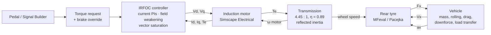
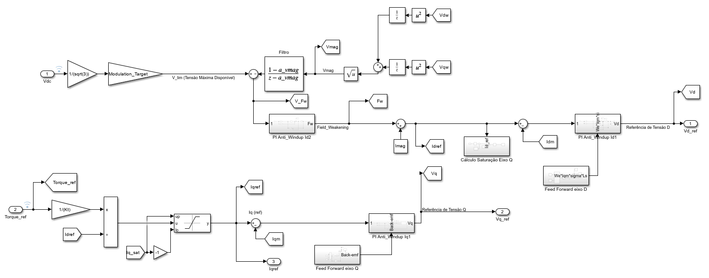
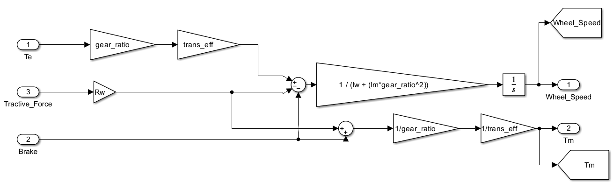
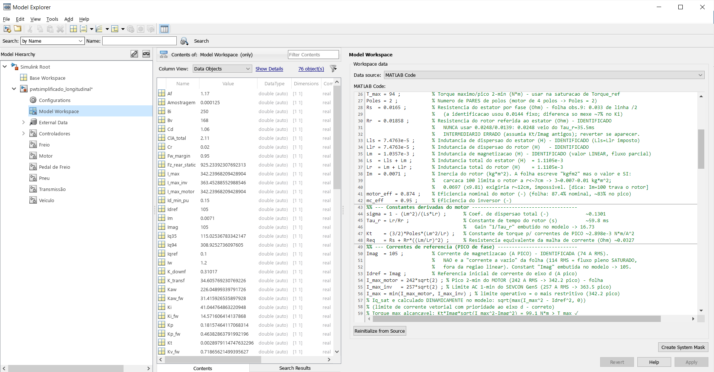

# AMP-226 Electric Powertrain Model

**Induction motor + IRFOC field-oriented control + longitudinal vehicle dynamics, in MATLAB/Simulink**


A physics-based simulation of the electric powertrain of **AMP-226**, the Formula SAE electric car of
**Ampera Racing** (Federal University of Santa Catarina, Brazil).
It models the whole chain from the driver's pedal to the tyre contact patch:

> pedal → torque request → **IRFOC current control (SEVCON Gen5)** → **4-pole induction motor** → gearbox → **Pacejka tyre (MFeval)** → vehicle

## Purpose

Every season the team designs a new car, but the powertrain architecture (induction motor, field-oriented
inverter, single-speed reduction, rear drive) carries over while the numbers change. This model is built
as a **modular, reusable tool**: replace the parameter set with next year's car data and the same model
answers the questions that drive the design and the setup of that car.

- **Design decisions for the next car.** Compare gear ratios, pack voltage and current limits, motor
  options, mass and aero targets by their effect on acceleration time, top speed, energy use and which
  limit (motor, inverter, battery or tyre) is active at each speed.
- **Inverter controller gains.** Design and stress-test the current-loop and field-weakening gains in
  simulation before they go on the SEVCON Gen5, where a bad gain means an inverter trip or an
  overheated motor instead of a plot.
- **Validation with the real car.** Feed logged inputs from track tests into the model and compare the
  outputs, to find which parameter, or which modelling assumption, is wrong.


---

## Highlights

- **Motor parameters identified from the manufacturer's dyno tables.** The original equivalent-circuit
  parameters were physically impossible: with the old torque constant, 110 A could produce at most
  24.4 N·m, while the dyno measured 35 N·m. A least-squares fit over the 20 rows of the datasheet's
  load tables (3.3 % RMS residual) gave a consistent set (Lm, Rr, Lσ, Kt, magnetising current).
- **Current loop designed analytically, not by trial and error.** Discrete PI at 8 kHz with
  Kp = σ·Ls·ωc and Ki = Req·ωc for a 200 Hz bandwidth, back-calculation anti-windup (Kaw = Ki/Kp),
  decoupling feed-forwards, and **vector** voltage and current saturation with priority to the d axis.
- **Field-weakening bug traced to a sample-time problem.** The voltage-magnitude measurement chain was
  inheriting the solver rate (80 kHz) instead of the controller rate (8 kHz), so it read the
  intra-sample ripple peak (+26 V) and weakened the field far too early. Fixing the sample time
  removed the limit cycle and gave **+52 % torque for the same phase current at 4 800 rpm**.
- **Tyre model 11× faster without changing a single result.** MFeval's limit checks call `warning()` at
  every solver step outside the `.tir` range (low speed, hard braking); silencing those two warnings in
  `InitFcn` took heavy-braking segments from 0.21 to 2.4 simulated s per minute.
- **Dynamic rear-axle load** from longitudinal load transfer and aerodynamic downforce, with a
  first-order filter that breaks the Fz → Fx → ax → Fz algebraic loop.

## Validation against the motor datasheet

The model is checked against the **load tables** of the datasheet, not the nameplate header (the
nameplate points are at saturated full flux, outside the linear model's validity range).

Rows 1–2 are steady-state values computed from the identified parameters; rows 3–5 come from the
full-throttle simulation below.

| Check | Target (datasheet) | Model |
| --- | --- | --- |
| Continuous 35 N·m, below base speed | 110–111 A RMS | 110.1 A RMS |
| Slip at 35 N·m | 3.0–3.3 Hz | 2.92 Hz |
| Peak torque | 94 N·m at 240 A RMS | 93.9 N·m at 230.7 A RMS |
| Slip at 94 N·m | ≈ 8 Hz | 7.83 Hz |
| Field-weakening knee at full torque | ≈ 2 970 rpm (2 820 rpm at 144 V, scaled to 168 V) | 2 968 rpm |

Vehicle-level predictions (366 kg with driver, full pack): **0–60 km/h in 5.09 s** and the
**75 m FSAE acceleration event in 6.77 s**. These are still to be confirmed on track — see
[Validation plan](#validation-plan).


Below the knee the model sits on the datasheet's 94 N·m line. In deep field weakening it is 5–8 % above
the datasheet curve scaled to 168 V. Two known reasons: the motor model is magnetically linear (no
saturation or iron losses), and the speed scaling from the 144 V dyno test to the 168 V pack is an
approximation. The battery is modelled as a constant 168 V source, so pack voltage sag under load is
not yet included.

## Model architecture



| Subsystem | What it does |
| --- | --- |
| **Controladores** | Indirect rotor-flux-oriented control: slip-frequency calculation, discrete d/q current PIs with anti-windup, decoupling and back-EMF feed-forwards, voltage-magnitude field-weakening PI, vector voltage/current limits, angle-delay compensation. |
| **Motor** | Simscape Electrical asynchronous machine (speed-imposed) fed by controlled voltage sources through inverse Park/Clarke, plus the measurement transforms. |
| **Transmissão** | Single-speed reduction, efficiency, motor + wheel inertia reflected to the wheel, rear brake torque. |
| **Pneu** | MFeval (Pacejka PAC2002) with the Avon `.tir` file; dynamic vertical load. |
| **Veículo** | Longitudinal equation of motion with rolling resistance, aerodynamic drag, downforce and front brake force. |
| **Pedal de Freio, Freio** | Brake pedal profile with the brake-override gate, and the rear brake torque applied in the transmission. |

All parameters live in the **Model Workspace** (Model Explorer → `pwtsimplificado_longitudinal` → Model
Workspace, source *MATLAB Code*), with a comment on every line stating its source.

## Inside the model

The top level chains the subsystems shown in the architecture diagram: the pedal map and brake gate,
`Controladores`, `Motor`, `Transmissão`, `Pneu` and `Veículo`, with the brake pedal profile and the rear
brake torque in their own subsystems (`Pedal de Freio`, `Freio`). Every block reads named parameters from
the Model Workspace, so none of the diagrams below contains car-specific numbers.

### Controller (`Controladores`)



This is the indirect rotor-flux-oriented controller that runs inside the SEVCON Gen5, discretised at 8 kHz.

- **Field weakening (top branch).** The available phase voltage is `V_lim = Vdc/√3 · Modulation_Target`.
  The applied voltage magnitude `Vmag = √(Vd² + Vq²)` is computed from the previous sample (`1/z`) and
  low-pass filtered at 50 Hz (`(1 − a)/(z − a)`). Their difference drives an anti-windup PI whose output
  `Fw` can only reduce the magnetising current: `Idref = Imag + Fw`, with `Fw ≤ 0`.
- **d-axis current loop.** `Idref − Idm` goes into an anti-windup PI. The decoupling feed-forward
  `−We·Iqm·σ·Ls` cancels the cross-coupling from the q axis, and the result is the d-axis voltage `Vd_ref`.
- **q-axis current loop (bottom branch).** The torque request becomes a current request through
  `Iq = T / (Kt · Idref)`, which follows from `Te = Kt · Id · Iq`. That request is clipped to `±Iq_sat`,
  where `Iq_sat = √(I_max² − Idref²)` comes from the *Cálculo Saturação Eixo Q* block, so the d axis
  always keeps priority on the current limit. The q-axis PI and the back-EMF feed-forward produce `Vq_ref`.

### Motor and inverter (`Motor`)


- **Actuation path.** `Vd_ref` and `Vq_ref` pass through a one-sample delay (the computation delay of a
  real controller), then the inverse Park and inverse Clarke transforms, and drive three controlled voltage
  sources connected to the Simscape asynchronous machine. The PWM itself is not modelled; the inverter is
  an ideal average voltage source.
- **Rotor-flux angle.** The slip frequency `Iqref / (Tau_r · Idref)` is added to the electrical rotor
  speed `Poles · wm` to get the synchronous speed `We`, which is integrated into the flux angle θ. The
  angle used by the inverse Park transform is advanced by `We · 1.5 · Ts` to compensate the sample and
  hold delays.
- **Measurement path.** Phase currents a and b go through Clarke and Park with the same angle to give
  `Idm` and `Iqm`, the feedback of the current loops. The machine also returns the electromagnetic torque
  `Te` and the rotor speed `wm`.
- The machine runs in speed-input mode: its shaft speed is the wheel speed times `gear_ratio`, so all the
  mechanical dynamics live in the transmission subsystem.

### Transmission (`Transmissão`)



A single rigid driveline written at the wheel:

```math
(I_w + I_m \cdot gr^2)\,\dot\omega_{wheel} = T_e \cdot gr \cdot \eta \;-\; F_x R_w \;-\; T_{brake}
```

The integrator output is the wheel speed. The load torque seen by the motor,
`(Fx·Rw + T_brake) / gr / η`, is sent back as `Tm` for monitoring.

### Rear tyre (`Pneu`)


The MFeval block evaluates the Pacejka (PAC2002) model of the Avon tyre, fitted to FSAE Tire Test Consortium data, from wheel speed and vehicle speed.
Its output `Fx` is per tyre, so it is doubled for the two driven wheels. The vertical load is dynamic:

```math
F_{z,rear} = F_{z,static} + K_{transf}\,\frac{a_x}{0.1\,s + 1} + K_{downf}\,V_x^2
```

Longitudinal load transfer comes from the vehicle's acceleration, filtered at 0.1 s to break the algebraic
loop Fz → Fx → ax → Fz, and the downforce term grows with speed squared. `mu_scale` scales the bench friction
of the `.tir` file down to track grip.

### Vehicle (`Veículo`)


```math
m\,\dot V = F_{tractive} - \tanh\!\left(\tfrac{V}{0.5}\right) m g C_r - \tfrac12 \rho C_d A_f V^2 - F_{brake,front}
```

The `tanh` terms smooth rolling resistance and the front brake force around zero speed, so the car does
not roll backwards when it stops. The front brake force is `Brake_pedal · brake_bias_f · T_brake_max / Rw`;
the rear share of the brake torque acts on the wheel in the transmission. The acceleration is published
as `ax` for the tyre load model.

### Parameters (Model Workspace)



All parameters are defined by a commented MATLAB script stored inside the model (Model Explorer → Model
Workspace, data source *MATLAB Code*). Derived quantities such as `sigma`, `Tau_r`, `Kt`, the PI gains and
the current limits are computed in the same script, so changing a motor or battery value updates every
block that depends on it.

## Main parameters

| Group | Parameter | Value | Source |
| --- | --- | --- | --- |
| Battery | Pack voltage / max DC current | 168 V (full) / 250 A | car spec |
| Motor | Rated / peak torque | 11 kW / 94 N·m | datasheet |
| Motor | Lm, Rr, Lσs = Lσr | 1.036 mH, 18.6 mΩ, 74.8 µH | identified |
| Motor | Rs | 16.5 mΩ | datasheet |
| Motor | Kt (peak currents), Imag | 2.898 mN·m/A², 105 A peak | identified |
| Inverter | Phase current limit | 342 A peak (motor 2-min limit) | datasheet |
| Control | Sampling, current-loop bandwidth | 8 kHz, 200 Hz | design |
| Control | Kp, Ki | 0.182 V/A, 41.0 V/(A·s) | design |
| Driveline | Gear ratio, efficiency, wheel radius | 4.45, 0.89, 0.2605 m | car spec |
| Vehicle | Mass, CdA, Cr | 366 kg, 1.24 m², 0.02 | car spec |
| Vehicle | Wheelbase, CG height, rear weight | 1.56 m, 0.295 m, 51.5 % | car spec |

Convention: phase currents and voltages are **peak values** (amplitude-invariant Park/Clarke). Datasheet
RMS values are multiplied by √2.

## Adapting the model to a new car

All car-specific numbers live in one script inside the model (Model Explorer → `pwtsimplificado_longitudinal`
→ Model Workspace, source *MATLAB Code*). The block diagram only reads those names, so a new car means a new
parameter set, not a new model. The script is grouped by subsystem:

| Group | What to update | Typical source |
| --- | --- | --- |
| Accumulator | `Bv`, `Bi` | pack design, BMS limits |
| Motor | `Rs`, `Rr`, `Lls`, `Llr`, `Lm`, `Poles`, `Im`, `T_max`, `I_max_motor` | datasheet, or identification from dyno tables |
| Inverter | `I_max_inv`, `mc_eff`, `Amostragem` | inverter datasheet |
| Controllers | `wc`, `wc_fw`, `Fw_margin`, `Modulation_Target` | design choices; `Kp`, `Ki`, `Kaw` and the field-weakening gains are **derived** from the motor data |
| Driveline | `gear_ratio`, `trans_eff`, `Rw`, `Iw` | drivetrain design, CAD |
| Brakes | `T_brake_max`, `brake_bias_f`, `brake_cut` | brake sizing, VCU strategy |
| Vehicle | `m`, `Cd`, `Af`, `Cr`, `L_wb`, `dist_cg_f`, `h_cg`, `ClA_total`, `downforce_rear_share` | weighing, aero simulations, CAD |
| Tyre | the `.tir` file in `data/` | tyre test data (TTC or supplier) |

The script ends with quick checks that print the derived quantities (σ, τr, Kt, controller gains,
`Kaw·Ts`, `wc·Ts`, maximum reachable torque) next to the datasheet acceptance targets every time the model
loads, so an inconsistent parameter set shows up before the first simulation. The expected values
written in those messages are AMP-226's and should be updated with the new car's datasheet.

## Getting started

**Requirements**

- MATLAB **R2025a**, Simulink, Simscape, Simscape Electrical
- [MFeval](https://www.mathworks.com/matlabcentral/fileexchange/63618-mfeval) (free, MATLAB File Exchange)

**Run**

```matlab
% from the repository root
addpath(genpath(pwd))
open_system('pwtsimplificado_longitudinal')
out = sim('pwtsimplificado_longitudinal');   % 12 s full-throttle run, then braking
plot_resultados(out)                          % regenerates the figures in docs/img
```

The default scenario (Signal Builder) is a full-throttle start followed by braking. A 12 s run takes a
few minutes: the model uses a fixed-step `ode3` solver at 1/10 of the 8 kHz control period so the
current loop is resolved inside each PWM period.

## Repository structure

```
├── pwtsimplificado_longitudinal.slx   Simulink model (parameters inside the Model Workspace)
├── data/
│   └── Avon_9760_Round_2.tir          Tyre coefficients for MFeval
├── scripts/
│   └── plot_resultados.m              Post-processing and figures
└── docs/
    └── img/                           Figures used in this README
```

## Validation plan

The motor side is validated against the manufacturer's dyno data. The vehicle side still relies on some
estimated parameters (brake torque, rotating inertias, tyre grip on track). A track test plan replays
measured inputs (motor speed, inverter torque, brake pressure) into the model layer by layer and compares
the outputs, so that a mismatch points to one parameter instead of fifteen.

## What's next

The [`develop`](../../tree/develop) branch extends this model with:

- **3-DOF chassis** (longitudinal, lateral, yaw) with an analytic front tyre calibrated on the same `.tir`
- steering inputs (step, slalom, skidpad, external log), **friction brakes** and **lift-off regenerative braking**
  limited by the battery's charge current
- a **pure-pursuit driver** that laps an FSAE autocross track, and a **3D replay** of the lap rendered to video

## Resumo em português

Modelo em MATLAB/Simulink do powertrain elétrico do **AMP-226**, carro de Formula SAE elétrico da
**Ampera Racing (UFSC)**: motor de indução Hércules com controle vetorial IRFOC (SEVCON Gen5),
transmissão, pneu Pacejka via MFeval e dinâmica longitudinal com transferência de carga e downforce.
A simulação é modular: trocando o conjunto de parâmetros pelos dados do carro do ano seguinte, o mesmo
modelo serve para decisões de projeto do carro futuro (relação de transmissão, tensão e corrente do
acumulador, motor, massa, aerodinâmica) e para encontrar ganhos melhores para os controladores do
inversor antes de passá-los ao SEVCON Gen5.
Os parâmetros do motor foram identificados por mínimos quadrados a partir das tabelas de dinamômetro
da folha de dados, os controladores de corrente e de enfraquecimento de campo foram projetados
analiticamente, e o modelo reproduz os pontos de teste do fabricante (torque, corrente, escorregamento
e joelho do enfraquecimento de campo). A branch `main` contém a versão longitudinal validada; a
`develop` traz o chassi 3-DOF, regeneração, piloto automático de pista e o replay 3D.

## Author

**Gabriel Hessmann Ramos** ([@GabrielH2003](https://github.com/GabrielH2003)) — powertrain team, Ampera Racing UFSC.
Vehicle data courtesy of Ampera Racing.
